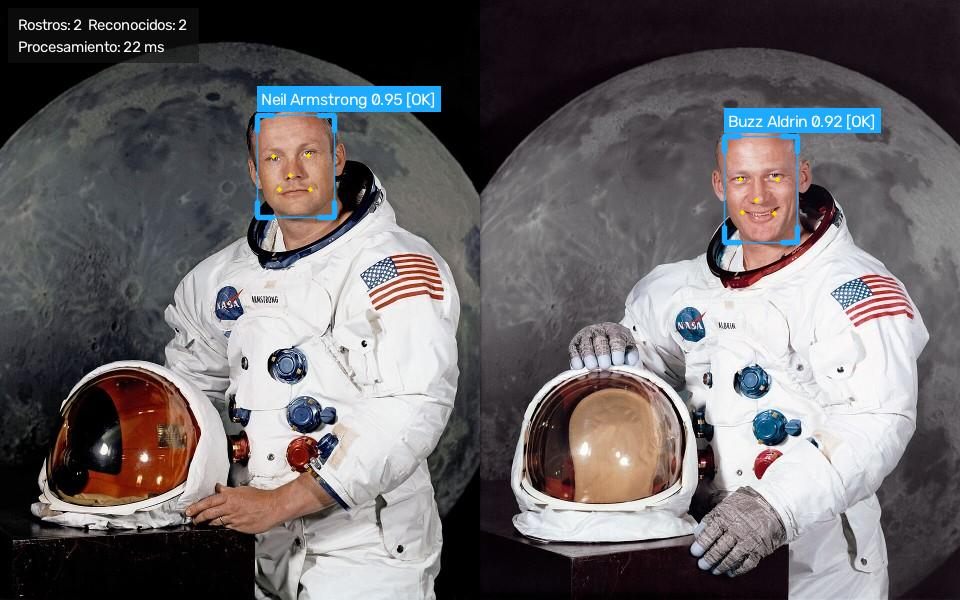
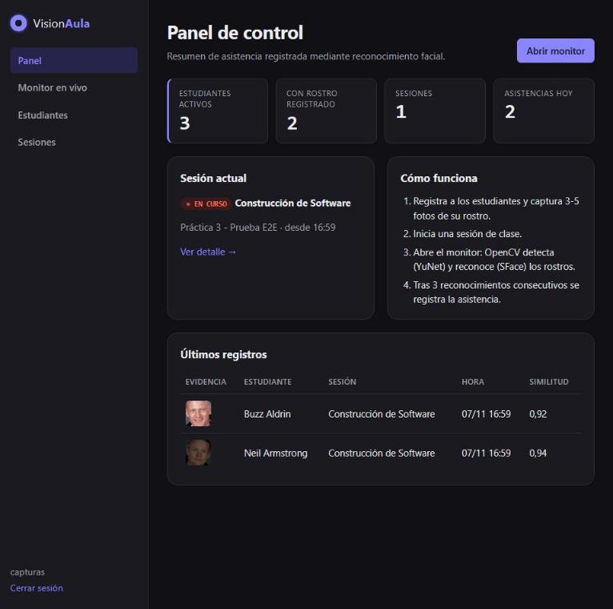
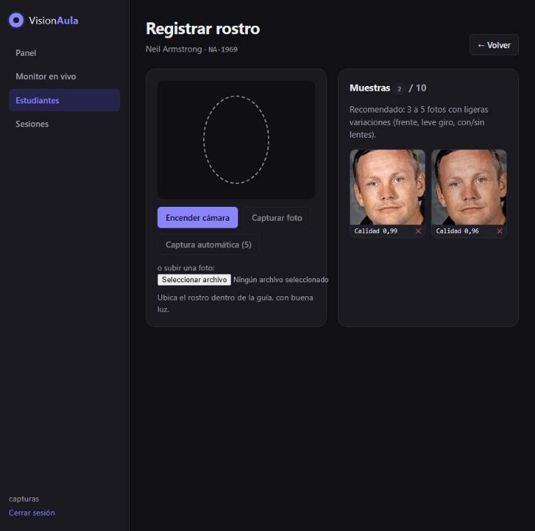
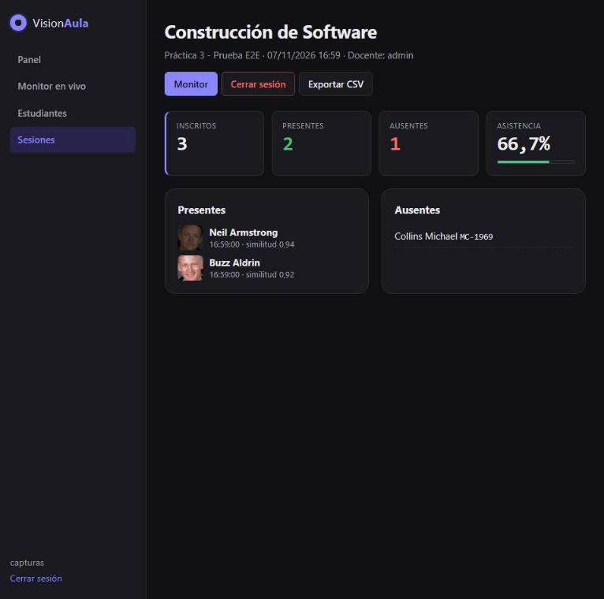
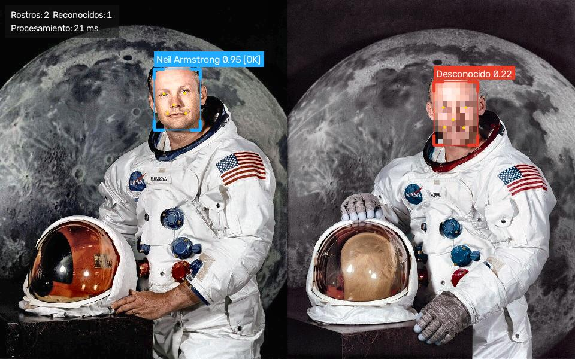

# VisionAula — Control de asistencia con reconocimiento facial

Aplicativo web en **Django** que captura video en tiempo real desde la cámara del navegador,
lo procesa con **OpenCV**, **detecta y reconoce** los rostros de los estudiantes y registra
automáticamente su asistencia en **PostgreSQL**.




> Universidad Estatal de Milagro (UNEMI) · Construcción de Software · Práctica 3 (G003-S12)
> Temática elegida: **Detección de rostros para control de asistencia**.

| Integrante | Rol |
|---|---|
| _Nombre 1_ | _Backend / OpenCV_ |
| _Nombre 2_ | _Frontend_ |
| _Nombre 3_ | _Base de datos_ |
| _Nombre 4_ | _Pruebas_ |
| _Nombre 5_ | _Documentación / video_ |

---

## Funcionalidades

| Eje de la rúbrica | Implementación |
|---|---|
| **Detección** | Red neuronal **YuNet** (`cv2.FaceDetectorYN`): caja del rostro + 5 puntos faciales. Funciona con varios rostros a la vez. |
| **Reconocimiento** | Red **SFace** (`cv2.FaceRecognizerSF`): alinea el rostro y genera un vector de 128 dimensiones; se compara por similitud coseno con la galería de estudiantes. |
| **Procesamiento** | Corrección automática de poca luz (**CLAHE** en espacio LAB), control de calidad de muestras (nitidez por **varianza del Laplaciano** y brillo), redimensionado para rendimiento, filtros de visualización (grises, **Canny**, mapa térmico) y **pixelado de desconocidos** (modo privacidad). |
| **Tiempo real** | El navegador captura la cámara (`getUserMedia`), envía fotogramas JPEG a Django y muestra el video anotado por OpenCV (hasta ~12 FPS; el procesamiento toma ≈25 ms por fotograma). |
| **Estabilidad** | La asistencia solo se registra tras **3 reconocimientos consecutivos** en 4 s (evita falsos positivos); restricción única por sesión en la BD; manejo de errores en cada capa. |

Otras características:

- Registro de estudiantes y **enrolamiento facial** (captura manual, automática de 5 fotos o subida de archivo).
- Sesiones de clase con monitor en vivo, barra de progreso de confirmación y notificación al registrar.
- Detalle por sesión: presentes (con **foto de evidencia**), ausentes, porcentaje y **exportación CSV**.
- Panel con estadísticas, modo claro/oscuro automático y diseño adaptable a pantallas pequeñas.
- Acceso protegido con usuario y contraseña (autenticación de Django).

## Capturas

| Panel de control | Registro de rostro |
|---|---|
|  |  |
| **Detalle de sesión** | **Modo privacidad (desconocido pixelado)** |
|  |  |

> Las fotos de prueba son retratos oficiales de la NASA (dominio público).

## Arquitectura

```
Navegador (cámara)          Django                                  OpenCV (vision/)
──────────────────          ──────                                  ────────────────
getUserMedia ──JPEG──▶ /api/procesar/ ──▶ services.procesar_frame ──▶ preprocessing (CLAHE)
                                                │                    detector (YuNet)
 ◀──JPEG anotado + JSON──┘                 │                    recognizer (SFace)
                                                ▼                    annotator (dibujo)
                                   tracker (3 fotogramas) ──▶ PostgreSQL (Asistencia)
```

```
visionaula/
├── config/                 # Configuración de Django (settings, urls)
├── vision/                 # Módulo OpenCV reutilizable, sin dependencia de Django
│   ├── codec.py            #   decodificar / codificar JPEG
│   ├── preprocessing.py    #   CLAHE, calidad, filtros
│   ├── detector.py         #   YuNet
│   ├── recognizer.py       #   SFace + galería + similitud coseno
│   ├── annotator.py        #   dibujo sobre el video
│   ├── pipeline.py         #   orquestación
│   └── model_store.py      #   descarga y verificación SHA-256 de modelos
├── asistencia/             # App Django
│   ├── models.py           #   Estudiante, MuestraRostro, SesionClase, Asistencia
│   ├── services.py         #   lógica de negocio
│   ├── tracker.py          #   confirmación temporal
│   ├── api.py              #   endpoints JSON
│   ├── views.py            #   vistas HTML
│   ├── templates/  static/ #   interfaz web (HTML, CSS, JS)
│   └── management/commands/descargar_modelos.py
├── templates/              # base.html y login
├── docs/                   # casos de prueba, guion del video, plantilla del informe
├── modelos/                # aquí se descargan los .onnx (no se suben a GitHub)
├── manage.py
├── requirements.txt        # dependencias del proyecto
├── ruff.toml               # reglas de estilo de código
└── .env.example            # plantilla de variables de entorno
```

## Requisitos

- Python 3.10 o superior
- PostgreSQL 14 o superior
- Una cámara web y un navegador moderno (Chrome, Edge o Firefox)

## Instalación

```bash
git clone https://github.com/JulioVera18/visionaula.git
cd visionaula
python -m venv venv
```

Activar el entorno virtual:

```bash
venv\Scripts\activate          # Windows
source venv/bin/activate       # Linux / macOS
```

```bash
pip install -r requirements.txt
copy .env.example .env         # Windows  (cp .env.example .env en Linux/macOS)
```

Edite `.env`: coloque una `DJANGO_SECRET_KEY` y los datos de su PostgreSQL.

### Base de datos PostgreSQL

Cree la base de datos desde pgAdmin o con `psql`:

```sql
CREATE DATABASE visionaula;
```

Los datos de conexión (`DB_NAME`, `DB_USER`, `DB_PASSWORD`, `DB_HOST`, `DB_PORT`) se configuran en `.env`.

### Migraciones, modelos y usuario

```bash
python manage.py migrate
python manage.py descargar_modelos
python manage.py createsuperuser
python manage.py runserver
```

Abra <http://localhost:8000> e inicie sesión.

> La cámara del navegador solo funciona en `localhost` o con HTTPS. Para usarla desde otra
> computadora de la red se necesita HTTPS (por ejemplo, un proxy inverso con certificado).

## Uso

1. **Estudiantes → Nuevo estudiante**: registre código, nombres y apellidos.
2. En **Registrar rostro**, encienda la cámara y use *Captura automática (5)*; gire levemente la cabeza entre capturas.
3. **Sesiones → Iniciar sesión** con la asignatura y el tema.
4. En el **Monitor en vivo**, pulse *Iniciar cámara*. Los rostros reconocidos aparecen en verde;
   al confirmarse 3 veces se registra la asistencia (marco azul `[OK]`) y aparece en la lista lateral.
5. Pruebe los filtros (CLAHE, grises, Canny, térmico) y el modo *Pixelar desconocidos*.
6. Cierre la sesión y exporte el **CSV** desde el detalle.

## Pruebas

El sistema se probó en funcionamiento con los casos de prueba de
[docs/CASOS_DE_PRUEBA.md](docs/CASOS_DE_PRUEBA.md): inicio de sesión, permisos de cámara,
registro de rostro, reconocimiento, poca luz, filtros, modo privacidad, sesiones y exportación CSV.

Estilo de código: `ruff check .` y `ruff format .` (configuración en `ruff.toml`).

## Configuración (`.env`)

| Variable | Descripción | Valor por defecto |
|---|---|---|
| `DJANGO_SECRET_KEY` | Clave secreta de Django | obligatoria si `DEBUG=False` |
| `DJANGO_DEBUG` | Modo desarrollo | `False` |
| `DB_ENGINE` | `postgresql` o `sqlite` | `postgresql` |
| `DB_NAME`, `DB_USER`, `DB_PASSWORD`, `DB_HOST`, `DB_PORT` | Conexión a PostgreSQL | `visionaula`, `postgres`, —, `localhost`, `5432` |
| `VISION_MATCH_THRESHOLD` | Similitud mínima para reconocer (0-1) | `0.40` |
| `VISION_DETECTION_SCORE` | Confianza mínima de detección | `0.80` |
| `VISION_CONFIRM_FRAMES` | Fotogramas consecutivos para registrar asistencia | `3` |
| `VISION_MAX_SAMPLES` | Máximo de fotos por estudiante | `10` |

## Seguridad y privacidad

- Todas las vistas y la API requieren inicio de sesión; los formularios y la API usan token CSRF.
- Las imágenes se validan (tamaño máximo 4 MB, formato y resolución) antes de procesarse.
- Se guardan los **embeddings** (vectores numéricos) y una miniatura del rostro; el video no se almacena.
- Las respuestas de error no exponen detalles internos; el CSV protege contra inyección de fórmulas.
- Los secretos se leen de `.env`, que está excluido del repositorio.

## Créditos

- Modelos [YuNet](https://github.com/opencv/opencv_zoo/tree/main/models/face_detection_yunet) y
  [SFace](https://github.com/opencv/opencv_zoo/tree/main/models/face_recognition_sface) de OpenCV Zoo.
- Referencia: Pressman, R. S. (2005). *Ingeniería del software: un enfoque práctico*. McGraw-Hill.
